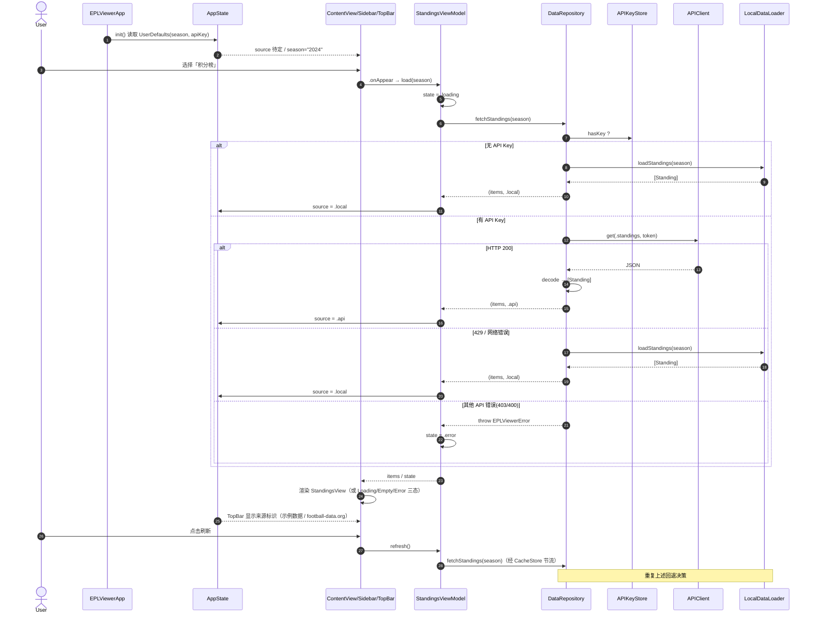
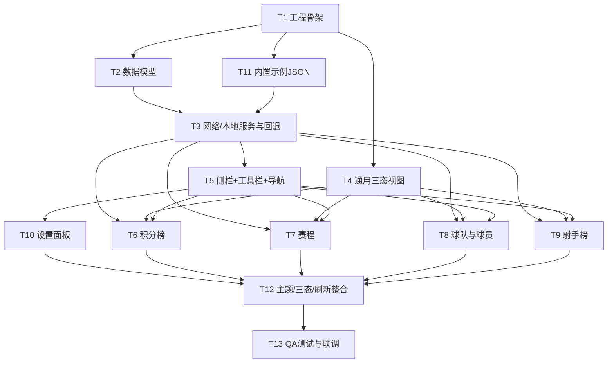

# EPL Viewer —— 系统架构设计 + 任务分解

> 作者：架构师 高见远（Gao）｜团队：software-epl-app
> 输入：产品经理 Alice 的 PRD（已确认版）
> 平台：macOS 26 (Tahoe) 原生 App｜技术栈：Swift + SwiftUI｜视觉：Liquid Glass

---

## 1. 实现方案与框架选型

### 1.1 核心难点

| 难点 | 说明 | 对策 |
|------|------|------|
| 混合数据源一致性 | API 与本地 JSON 字段必须完全一致，否则 Repository 无法统一解析 | 本地 JSON **严格复用 football-data.org v4 的字段名**（snake_case），模型统一用 `keyDecodingStrategy = .convertFromSnakeCase` 转 camelCase |
| 限频与降级 | 免费层约 10 次/分钟，429/断网/无 Key 须回退本地 | `DataRepository` 集中决策；失败即降级本地并返回 `DataSource.local` |
| 数据非实时 | 按周期更新，需节流避免频繁打 API | 进程内 `CacheStore`（带 TTL）+ 上次刷新时间戳节流（P2 自动刷新） |
| Liquid Glass 视觉 | macOS 26 新材质需落在侧栏/工具栏/卡片 | 统一封装在 `Sidebar`/`TopBar` 与卡片容器，避免散落 |
| 沙箱不可编译 | 工程师需无需 Xcode 交互即可落盘全部源文件 | 采用 **SwiftPM 布局**（单一 target + resources），`swift build` / `swift run` 即可运行 |

### 1.2 框架 / 库选型

- **App 生命周期**：`@main` + `WindowGroup`（SwiftUI App 协议）。单一 window，`NavigationSplitView` 承载「侧栏 + 内容区」。
- **状态管理**：优先 `Observation` 框架的 `@Observable`（macOS 14+/26 原生，无手动 `@Published`）。App 级共享状态（`AppState`：选中板块、赛季、数据来源、设置面板开关）通过 `.environment()` 注入；各板块 `ViewModel` 为 `@Observable` 并 `@State` 持有于对应 View。
- **网络层**：**原生 `URLSession` + `async/await`**，不引入第三方网络库。`APIClient` 薄封装，统一拼 URL、注入 `X-Auth-Token`、解析 429 / 网络错误。
- **图片加载**：队徽/球场图优先 **原生 `AsyncImage`**（无需 Kingfisher）。若后续需缓存再评估 Kingfisher。
- **JSON 解析**：`Codable` + `JSONDecoder.convertFromSnakeCase`。内置 JSON 随包（`Bundle.module`）。
- **第三方依赖**：**无强制第三方库**。仅系统框架：`SwiftUI`、`Observation`、`Foundation`。

### 1.3 架构模式

- **MVVM + Repository**：View 持有 `@Observable` ViewModel；ViewModel 依赖 `DataRepository`；Repository 聚合 `APIClient`(远程) / `LocalDataLoader`(本地) / `CacheStore`(缓存) / `APIKeyStore`(密钥) / `SeasonStore`(赛季)。
- **依赖方向**：`View → ViewModel → DataRepository → (APIClient | LocalDataLoader)`，`Store` 类为叶子（读写 `UserDefaults`/`Bundle`）。

### 1.4 Liquid Glass 应用位置清单

| 位置 | 修饰符 | 说明 |
|------|--------|------|
| 左侧导航侧边栏 | `.glassBackgroundEffect()` 于背景 | 侧栏整体玻璃材质 |
| 顶部工具栏 | `.glassEffect()` | 标题/赛季/刷新/来源标识/设置容器 |
| 板块切换项（Sidebar 行） | `.glassEffect()`（选中态） | 高亮当前板块 |
| 内容卡片（积分榜/赛程/球队/射手） | `.glassEffect()` 包裹 `VStack`/`List` 行 | 列表/卡片玻璃质感 |
| 来源标识 Badge（示例数据 / football-data.org） | `.glassEffect()` 胶囊 | 顶部来源提示 |
| 加载/错误浮层按钮 | `.glassEffect()` | 刷新按钮、重试按钮 |
| 设置面板弹窗 | `.glassBackgroundEffect()` | 设置表单背景 |

> 深/浅色跟随系统：不调用 `.preferredColorScheme(...)` 强制色系，Liquid Glass 自动适配；设置面板仅暴露「跟随系统」。

---

## 2. 文件列表与相对路径（SwiftPM 友好布局）

```
PremierLeague/
├── Package.swift                         # SwiftPM 清单（声明 target + Resources）
├── README.md
├── Sources/
│   └── EPLViewer/
│       ├── EPLViewerApp.swift            # @main 入口（WindowGroup）
│       ├── AppState.swift                # @Observable 全局共享状态
│       ├── Models/
│       │   ├── Competition.swift         # 赛事（id/name/code/emblem）
│       │   ├── Team.swift                # 球队（含 coach? / squad? 可选）
│       │   ├── Player.swift              # 球员（name/position/shirtNumber/nationality）
│       │   ├── Standing.swift            # 单条积分记录
│       │   ├── Match.swift               # 单场比赛（含 Score）
│       │   ├── Score.swift               # 比分（fullTime/halfTime）
│       │   ├── Scorer.swift              # 射手条目（player/team/goals）
│       │   ├── Responses.swift           # API 包装体：StandingsResponse/MatchesResponse/TeamsResponse/ScorersResponse/TeamDetailResponse
│       │   ├── DataSource.swift          # 枚举：.api / .local + label
│       │   └── EPLViewerError.swift      # 统一错误类型 + ViewState 三态枚举
│       ├── Services/
│       │   ├── Endpoint.swift            # 端点枚举 + baseURL + path/query
│       │   ├── APIClient.swift           # URLSession 封装（get(_:token:)）
│       │   ├── APIKeyStore.swift         # UserDefaults 读写 API Key
│       │   ├── SeasonStore.swift         # UserDefaults 读写当前赛季/可选列表
│       │   ├── LocalDataLoader.swift     # 读取 Bundle.module 内 JSON
│       │   ├── CacheStore.swift          # 进程内缓存（NSCache + TTL）
│       │   └── DataRepository.swift      # 回退决策核心
│       ├── ViewModels/
│       │   ├── StandingsViewModel.swift
│       │   ├── FixturesViewModel.swift
│       │   ├── TeamsViewModel.swift
│       │   └── TopScorersViewModel.swift
│       ├── Views/
│       │   ├── ContentView.swift         # NavigationSplitView 容器
│       │   ├── Sidebar.swift             # 左侧 4 板块 + 设置
│       │   ├── TopBar.swift              # 顶部工具栏（标题/赛季/刷新/来源/设置）
│       │   ├── StandingsView.swift
│       │   ├── FixturesView.swift
│       │   ├── TeamsView.swift
│       │   ├── TeamDetailView.swift
│       │   ├── TopScorersView.swift
│       │   ├── SettingsView.swift
│       │   └── Common/
│       │       ├── LoadingView.swift     # 加载中三态之一
│       │       ├── EmptyView.swift       # 空态三态之一
│       │       └── ErrorView.swift       # 错误态三态之一（含重试）
│       └── Resources/
│           ├── standings.json            # 内置示例：积分榜（结构同 /standings）
│           ├── matches.json              # 内置示例：赛程赛果（结构同 /matches）
│           ├── teams.json                # 内置示例：球队列表（结构同 /teams）
│           ├── scorers.json              # 内置示例：射手榜（结构同 /scorers）
│           └── competition.json          # 内置示例：赛事信息
└── Tests/
    └── EPLViewerTests/
        └── DataRepositoryTests.swift    # 回退逻辑单测（无 Key→local / 429→local）
```

### 工程文件如何生成（无需 Xcode 交互）

- **唯一必需配置文件：`Package.swift`**（见 §6）。工程师按 §2 路径新建所有 `.swift` / `.json` 文件即可，**无需 `.xcodeproj`**。
- 本地验证：`swift build`（编译）、`swift run`（启动 GUI 窗口）。
- 如需 Xcode：在根目录执行 `swift package generate-xcodeproj` 自动生成工程；或 `File → Add Package` 打开含 Package.swift 的目录。
- **Info.plist**：SwiftPM 模式不需要。football-data.org 为 **HTTPS**，默认 ATS 已放行，**无需** `NSAppTransportSecurity` 例外。
- **Assets.xcassets**：可选。Liquid Glass 与 SF Symbols 无需资源目录；如需自定义 App 图标再补 `Assets.xcassets`（SwiftPM 中通过 `resources: [.process("Resources")]` 一并打包）。
- **网络权限**：`swift run` 默认非沙盒，可直接联网；若走 Xcode 分发包，需在 Signing & Capabilities 开启 **Outgoing Connections (Client)**。

---

## 3. 数据结构与接口

> 约定：所有模型属性用 **camelCase**；JSON 源字段为 **snake_case**，由 `JSONDecoder(keyDecodingStrategy: .convertFromSnakeCase)` 统一转换。本地 JSON 与 API 返回**使用完全相同的 snake_case 字段名**，保证 `DataRepository` 用同一组 `Decodable` 解析。

### 3.1 核心模型（Mermaid 类图，详见 `docs/class-diagram.mermaid`）

```mermaid
classDiagram
    direction LR

    class Competition {
        +Int id
        +String name
        +String code
        +String emblem
    }

    class Team {
        +Int id
        +String name
        +String shortName
        +String tla
        +String crest
        +String venue
        +Coach~opt~ coach
        +Array~Player~ squad
    }

    class Coach {
        +Int id
        +String name
        +String nationality
    }

    class Player {
        +Int id
        +String name
        +String position
        +Int~opt~ shirtNumber
        +String nationality
    }

    class Standing {
        +Int position
        +Team team
        +Int playedGames
        +Int won
        +Int draw
        +Int lost
        +Int points
        +Int goalsFor
        +Int goalsAgainst
        +Int goalDifference
        +String~opt~ form
        +String~opt~ status
    }

    class Match {
        +Int id
        +String utcDate
        +String status
        +Int matchday
        +Team homeTeam
        +Team awayTeam
        +Score score
    }

    class Score {
        +ScoreDetail fullTime
        +ScoreDetail halfTime
    }

    class ScoreDetail {
        +Int~opt~ home
        +Int~opt~ away
    }

    class Scorer {
        +Player player
        +Team team
        +Int goals
        +Int~opt~ assists
        +Int~opt~ playedMatches
    }

    class DataSource {
        <<enum>>
        +api
        +local
        +label String
    }

    Team "1" *-- "0..1" Coach : has
    Team "1" *-- "0..*" Player : squad
    Standing --> Team : team
    Match --> Team : homeTeam
    Match --> Team : awayTeam
    Match --> Score : score
    Score *-- ScoreDetail : fullTime
    Score *-- ScoreDetail : halfTime
    Scorer --> Player : player
    Scorer --> Team : team

    class Endpoint {
        <<enum>>
        +standings(season String)
        +matches(season String)
        +teams
        +team(id Int)
        +scorers(season String)
        +path String
        +query Array~URLQueryItem~
    }

    class APIClient {
        -URLSession session
        +get(_ endpoint Endpoint, token String) async throws Data
    }

    class APIKeyStore {
        -UserDefaults defaults
        +key String~opt~ {get set}
        +hasKey Bool
    }

    class SeasonStore {
        -UserDefaults defaults
        +current String
        +available Array~String~
    }

    class LocalDataLoader {
        -Bundle bundle
        +loadStandings(season String) Array~Standing~
        +loadMatches(season String) Array~Match~
        +loadTeams() Array~Team~
        +loadScorers(season String) Array~Scorer~
        +loadCompetition() Competition
    }

    class CacheStore {
        -NSCache cache
        +value(forKey String) Any~opt~
        +set(_ value Any, forKey String)
    }

    class DataRepository {
        -APIClient api
        -APIKeyStore keyStore
        -LocalDataLoader local
        -CacheStore cache
        +fetchStandings(season String) async ([Standing], DataSource)
        +fetchMatches(season String) async ([Match], DataSource)
        +fetchTeams() async ([Team], DataSource)
        +fetchTeam(id Int) async (Team, DataSource)
        +fetchScorers(season String) async ([Scorer], DataSource)
    }

    APIClient --> Endpoint : builds URL
    DataRepository --> APIClient : uses
    DataRepository --> APIKeyStore : reads
    DataRepository --> LocalDataLoader : fallback
    DataRepository --> CacheStore : caches

    class AppState {
        <<@Observable>>
        +DataSource source
        +String season
        +Section selection
        +Bool showSettings
    }

    class StandingsViewModel {
        <<@Observable>>
        -DataRepository repo
        +ViewState state
        +Array~Standing~ items
        +load(season String) async
        +refresh() async
    }
    class FixturesViewModel {
        <<@Observable>>
        -DataRepository repo
        +ViewState state
        +Array~Match~ items
        +filter: MatchFilter
        +load(season String) async
    }
    class TeamsViewModel {
        <<@Observable>>
        -DataRepository repo
        +ViewState state
        +Array~Team~ teams
        +selected: Team~opt~
        +loadTeamDetail(id Int) async
    }
    class TopScorersViewModel {
        <<@Observable>>
        -DataRepository repo
        +ViewState state
        +Array~Scorer~ items
        +load(season String) async
    }

    StandingsViewModel --> DataRepository : uses
    FixturesViewModel --> DataRepository : uses
    TeamsViewModel --> DataRepository : uses
    TopScorersViewModel --> DataRepository : uses

    class ContentView
    class Sidebar
    class TopBar
    class StandingsView
    class FixturesView
    class TeamsView
    class TeamDetailView
    class TopScorersView
    class SettingsView
    class LoadingView
    class EmptyView
    class ErrorView

    ContentView --> Sidebar
    ContentView --> TopBar
    Sidebar --> AppState : reads
    TopBar --> AppState : reads
    StandingsView --> StandingsViewModel : observes
    FixturesView --> FixturesViewModel : observes
    TeamsView --> TeamsViewModel : observes
    TopScorersView --> TopScorersViewModel : observes
    TeamDetailView --> TeamsViewModel : observes
    SettingsView --> APIKeyStore : binds
    SettingsView --> SeasonStore : binds
```

### 3.2 Service 接口方法签名（Swift 风格）

```swift
// 端点定义
enum Endpoint {
    case standings(season: String)
    case matches(season: String)
    case teams
    case team(id: Int)
    case scorers(season: String)

    var path: String            // 例如 "/v4/competitions/PL/standings"
    var query: [URLQueryItem]   // 例如 [URLQueryItem(name: "season", value: "2024")]
}

// 远程客户端
struct APIClient {
    func get(_ endpoint: Endpoint, token: String) async throws -> Data
}

// 密钥 / 赛季存储（UserDefaults）
struct APIKeyStore {
    var key: String? { get set }   // 空串视为无 Key
    var hasKey: Bool { get }
}
struct SeasonStore {
    var current: String            // 默认 "2024"
    var available: [String]        // 例如 ["2023","2024"]
}

// 本地示例数据
struct LocalDataLoader {
    func loadStandings(season: String) -> [Standing]
    func loadMatches(season: String)   -> [Match]
    func loadTeams()                   -> [Team]
    func loadScorers(season: String)   -> [Scorer]
    func loadCompetition()             -> Competition
}

// 回退聚合层（核心）
struct DataRepository {
    func fetchStandings(season: String) async -> ([Standing], DataSource)
    func fetchMatches(season: String)   async -> ([Match],     DataSource)
    func fetchTeams()                   async -> ([Team],      DataSource)
    func fetchTeam(id: Int)             async -> (Team,        DataSource)  // 取详情含 coach/squad
    func fetchScorers(season: String)   async -> ([Scorer],    DataSource)
}
```

### 3.3 `DataRepository` 回退决策逻辑（伪代码）

```
func fetchStandings(season) async -> ([Standing], DataSource):
    if cache 命中且未过期: return (cache, 上次 source)

    guard apiKeyStore.hasKey else:
        return (localDataLoader.loadStandings(season), .local)   // ① 无 Key → 本地

    do:
        let data = try await apiClient.get(.standings(season), token: apiKeyStore.key!)
        let resp = try decode(StandingsResponse.self, from: data)
        let items = resp.standings.first?.table ?? []
        cache.set(items, forKey: "standings-\(season)")
        return (items, .api)                                      // ② 正常 → API
    catch let e where e.isHTTP429 or e.isNetworkOffline:
        return (localDataLoader.loadStandings(season), .local)   // ③ 限流/断网 → 本地
    catch:
        throw e                                                    // 其他 API 错误(403/400) → 上抛错误态
```

> 仅「无 Key / 429 / 断网」三种情况回退本地；403（Key 无效）、400（赛季非法）等按错误态呈现（`ErrorView`），不静默降级。所有分支最终都会把 `DataSource` 写回 `AppState.source`，由 `TopBar` 显示「示例数据」或「football-data.org」。

---

## 4. 程序调用流程（时序图，详见 `docs/sequence-diagram.mermaid`）



---

## 5. 任务列表（有序，含依赖，按实现顺序）

> 说明：本任务清单遵循**团队主理人的显式要求**，按板块/模块拆分为 T1–T13 的细粒度列表（覆盖工程骨架、模型、服务、通用视图、导航、四大板块、设置、内置数据、整合、QA）。此粒度超出通用「≤5 任务」默认上限，系主理人针对本原生多模块 App 的明确指示，特此说明。

| 任务 | 名称 | 源文件（≥3） | 依赖 | 优先级 |
|------|------|--------------|------|--------|
| **T1** | 工程骨架与入口 | `Package.swift`、`EPLViewerApp.swift`、`AppState.swift`、`README.md` | — | P0 |
| **T2** | 数据模型层 | `Models/Competition.swift`、`Team.swift`、`Player.swift`、`Standing.swift`、`Match.swift`、`Score.swift`、`Scorer.swift`、`Responses.swift`、`DataSource.swift`、`EPLViewerError.swift` | T1 | P0 |
| **T3** | 网络/本地服务与回退 | `Services/Endpoint.swift`、`APIClient.swift`、`APIKeyStore.swift`、`SeasonStore.swift`、`LocalDataLoader.swift`、`CacheStore.swift`、`DataRepository.swift` | T2 | P0 |
| **T4** | 通用三态视图 | `Views/Common/LoadingView.swift`、`EmptyView.swift`、`ErrorView.swift` | T1 | P1 |
| **T5** | 侧边栏 + 顶部工具栏 + 导航容器 | `Views/ContentView.swift`、`Sidebar.swift`、`TopBar.swift` | T3, T4 | P1 |
| **T6** | 板块① 积分榜 | `Views/StandingsView.swift`、`ViewModels/StandingsViewModel.swift` | T3, T4, T5 | P0 |
| **T7** | 板块② 赛程赛果 | `Views/FixturesView.swift`、`ViewModels/FixturesViewModel.swift` | T3, T4, T5 | P0 |
| **T8** | 板块③ 球队与球员 | `Views/TeamsView.swift`、`TeamDetailView.swift`、`ViewModels/TeamsViewModel.swift` | T3, T4, T5 | P0 |
| **T9** | 板块④ 射手榜 | `Views/TopScorersView.swift`、`ViewModels/TopScorersViewModel.swift` | T3, T4, T5 | P0 |
| **T10** | 设置面板 | `Views/SettingsView.swift` | T3, T5 | P1 |
| **T11** | 内置示例 JSON | `Resources/standings.json`、`matches.json`、`teams.json`、`scorers.json`、`competition.json` | T1 | P0 |
| **T12** | 主题/三态/刷新/来源标识整合 | `AppState.swift`(扩展)、`TopBar.swift`(刷新+来源)、各 View 接入三态、`Tests/.../DataRepositoryTests.swift` | T6, T7, T8, T9, T10, T11 | P1 |
| **T13** | QA 测试与联调 | `Tests/EPLViewerTests/DataRepositoryTests.swift`、整体 `swift build`/`swift run` 验证 | T12 | P2 |

> 依赖关系要点：T2 依赖 T1；T3 依赖 T2（回退解析需模型）；T5/T6/T7/T8/T9 共享 T3+T4+T5；T11 与 T3 解耦但需先于整合；T12 整合全部板块；T13 收尾。P2（跨板块联动、搜索、自动刷新节流）在 T8/T9 预留跳转入口、T12 接入节流，可在 T13 前后增量实现。

---

## 6. 依赖包列表

| 包 | 版本/来源 | 用途 | 是否必需 |
|----|-----------|------|----------|
| `swift` 工具链（macOS 26 SDK） | 系统 | 编译/运行（含 SwiftUI、Observation、Foundation） | 必需 |
| **无第三方网络/图片库** | — | `URLSession` + `AsyncImage` 已足够 | — |
| （可选）`Kingfisher` | 最新 | 队徽磁盘缓存（仅在 `AsyncImage` 不满足时引入） | 可选 |
| （可选）`SnapshotTesting` | 最新 | UI 快照测试 | 可选（QA） |

`Package.swift` 最小清单（单一可执行 target + 资源）：

```swift
// swift-tools-version:6.0
import PackageDescription

let package = Package(
    name: "PremierLeague",
    platforms: [.macOS("26.0")],
    targets: [
        .executableTarget(
            name: "EPLViewer",
            path: "Sources/EPLViewer",
            resources: [.process("Resources")]
        ),
        .testTarget(
            name: "EPLViewerTests",
            dependencies: ["EPLViewer"],
            path: "Tests/EPLViewerTests"
        )
    ]
)
```

---

## 7. 共享知识（跨文件约定）

- **API 基础信息**
  - Base URL：`https://api.football-data.org`
  - 路径（v4）：`/v4/competitions/PL/standings`、`/v4/competitions/PL/matches`、`/v4/competitions/PL/teams`、`/v4/competitions/PL/teams/{id}`、`/v4/competitions/PL/scorers`
  - 认证头：`X-Auth-Token: <user API Key>`（存 `APIKeyStore`/UserDefaults）
  - 赛季参数：`?season=2024`（格式为起始年份字符串，如 `2024` 代表 2024/25 赛季）
- **JSON ↔ 模型映射约定**
  - 所有 JSON 字段 **snake_case**，模型属性 **camelCase**；统一 `JSONDecoder.keyDecodingStrategy = .convertFromSnakeCase`。
  - 内置 JSON 与 API 返回**字段名完全一致**（这是回退可用的前提）。
  - 关键字段对齐：`position, playedGames, won, draw, lost, points, goalsFor, goalsAgainst, goalDifference, status, form`（standings）；`utcDate, status, matchday, homeTeam, awayTeam, score.fullTime.{home,away}`（matches）；`id, name, shortName, tla, crest, venue, coach{nationality}, squad[]{position, shirtNumber, nationality}`（teams/team-detail）；`player, team, goals, assists, playedMatches`（scorers）。
- **错误类型（`EPLViewerError`）**：`invalidKey(403)`、`badSeason(400)`、`rateLimited(429)`、`offline`、`decodeFailure`、`unknown`。`ViewState` 三态：`idle / loading / loaded / empty / error(EPLViewerError)`，全 App 统一用 `LoadingView / EmptyView / ErrorView` 呈现。
- **数据来源标识（`DataSource.label`）**：`.api → "football-data.org"`，`.local → "示例数据"`；由 `AppState.source` 驱动 `TopBar` Badge。
- **命名规范**：View 以 `View` 结尾；ViewModel 以 `ViewModel` 结尾且为 `@Observable`；Service/Store 用名词结构体；模型用值类型 `struct`；枚举 `DataSource`/`ViewState`/`Endpoint`/`EPLViewerError` 全大写首字母。
- **缓存与节流**：`CacheStore` 以 `"\(endpoint)-\(season)"` 为 key，TTL ≈ 5 分钟；自动刷新（P2）比较上次时间戳，间隔 < 30s 跳过，避免触发 10 次/分钟限频。
- **网络权限**：HTTPS 默认放行，无需 ATS 例外；分发包开启 Outgoing Connections。

---

## 8. 待明确事项（需主理人/用户拍板）

1. **赛季可选范围**：默认仅 `2024` 单赛季？还是提供 `2023/2024` 下拉？免费层覆盖单赛季，建议 `SeasonStore.available = ["2023","2024"]`，默认 `2024`。请确认列表与默认项。
2. **队徽/球场图加载**：用原生 `AsyncImage` 直连网络（可能慢/偶发失败）是否可接受？或要求内置占位图？建议先 `AsyncImage` + SF Symbol 占位。
3. **球队详情数据来源**：API 需额外调用 `/v4/teams/{id}`（每次打开详情 1 次请求）以获取 coach/squad；是否接受按需单请求 + 缓存？还是要求 teams 列表自带 squad（会增大本地 JSON）？建议前者（按需 + `CacheStore`）。
4. **P2 自动刷新节流阈值**：默认 30s 最小值是否合理？
5. **跨板块联动深度**：点击射手/球员跳球队详情（T8/T9 已预留），是否还需「反向」从球队详情跳回射手榜？默认单向。
6. **App 图标 / 品牌色**：是否提供自定义图标？否则用系统默认 + Liquid Glass 自动配色。
7. **单测深度**：T13 仅覆盖 `DataRepository` 回退逻辑，是否需补充 ViewModel 单测？

---

## 9. 任务依赖图（Mermaid）


